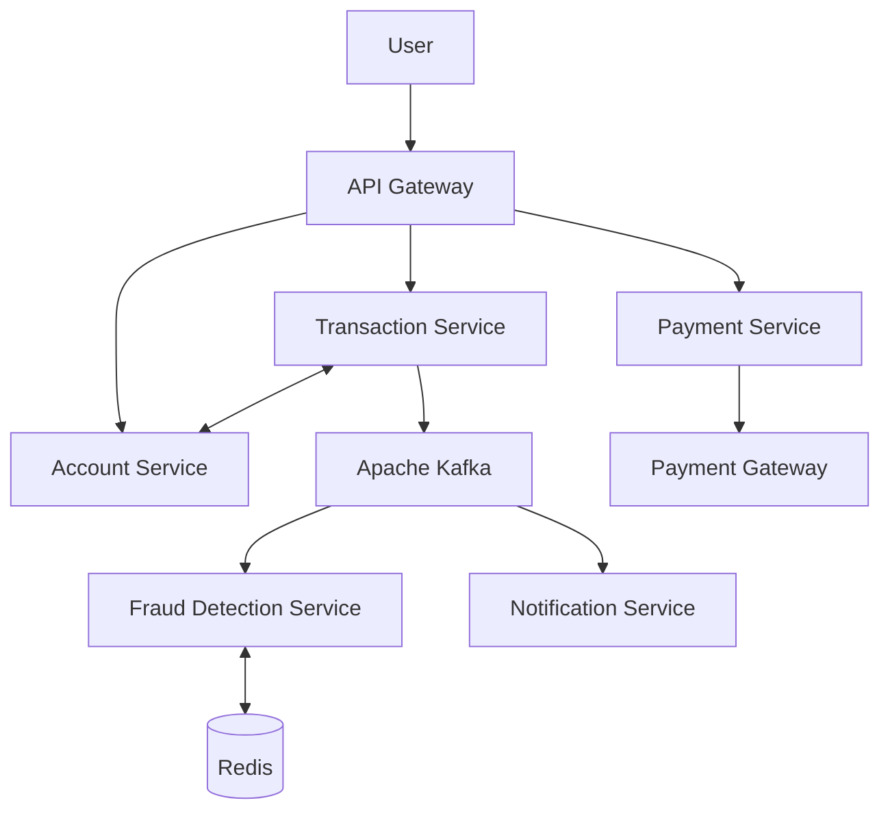

# NobiPe – Distributed Digital Banking & Fraud Detection Platform

**NobiPe** is a microservices-based digital banking application designed for secure money transfers, account management, real-time fraud detection, and payment processing.

## Features

* **Account Service:** User registration, account creation, and balance management.
* **Transaction Service:** Money transfers, transaction tracking, and SAGA-based consistency.
* **Fraud Detection Service:** Real-time fraud checks using velocity rules, transaction thresholds, and Redis.
* **Notification Service:** Email/SMS alerts for transactions, fraud, and OTP verification.
* **Payment Service:** Payment gateway integration, order creation, and webhook processing.
* **API Gateway:** Centralized routing and rate limiting.
* **Apache Kafka:** Asynchronous communication between microservices.

## Architecture

## Tech Stack

* **Backend:** Java, Spring Boot
* **Messaging:** Apache Kafka
* **Caching:** Redis
* **Security:** Spring Security, JWT
* **Infrastructure:** Docker, API Gateway
* **Integrations:** Razorpay, Email/SMS providers

## Key Concepts

* Microservices architecture
* SAGA pattern and compensating transactions
* Event-driven communication
* Idempotency and transaction consistency
* Real-time fraud detection
* Secure payment webhook handling

## Getting Started

1. Clone the repository.
2. Configure environment variables and database credentials.
3. Start infrastructure using Docker Compose, if configured.
4. Build and run the Spring Boot services.
5. Test the APIs using Postman.
